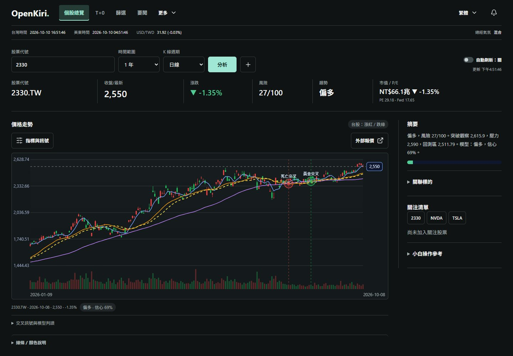
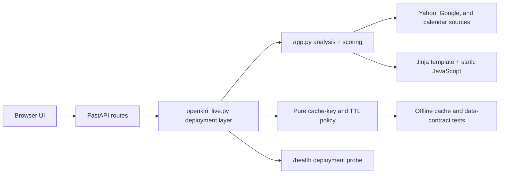

# OpenKiri

OpenKiri is a FastAPI stock-risk dashboard for Taiwan and US stocks. It groups tickers by trend-continuation setups, shows technical risk, and displays sourced market-cap and P/E data with reported/estimated labels.

Public website:

```text
https://stock-risk-radar.onrender.com/#
```



_The deployed dashboard combines a ticker workflow, technical-risk summary, valuation context, and decision-support levels in one responsive view._

## Features

- Task-based workspace with a chart-first overview, separate T+0/screener/news views, accessible controls, explicit loading/error states, and keyboard chart inspection. See [UI acceptance criteria](docs/ui-criteria.md).

- Clean single-screen stock dashboard for Taiwan and US symbols such as `2330`, `2330.TW`, `AAPL`, `NVDA`, and `TSLA`.
- Yahoo chart data with MA5, MA20, MA60, RSI, MACD, ATR, volume ratio, and 20-day return.
- Setup filters for golden-cross continuation, golden-cross watch, death-cross continuation, death-cross watch, bullish/bearish MA continuation, volume breakout, MA20 pullback hold, oversold rebound, overheat risk, and mixed consolidation.
- Screener grouping by market, industry, setup type, signal score, low P/E, market cap, risk, change, price, or volume.
- Valuation uses TWSE/TPEx daily data, Nasdaq reported US market cap, and dated Yahoo TTM EPS. Listed Taiwan cap and calculated US P/E are explicitly estimated; each field retains its own source/date. Unsupported or missing values, including forward P/E, remain unavailable. Static estimates never populate valuation cards.
- Separate source timestamps and retrieval timestamps for prices, chart bars, and valuation. Technical analysis loads first; slower valuation loads independently and news/event analysis is optional.
- Conservative market-session and data-age labels distinguish supplied regular/pre/post sessions, regular weekends, historical closes, delayed observations, and daily intraday fallbacks. Unknown holiday/session information is not guessed. Status checks add no upstream requests.
- T+0 candidate lists exclude delayed, unconfirmed, daily-fallback and invalid-time observations. Confirmed last-session results appear in a separate collapsible reference list with bar timestamps; cached rows are reclassified at session boundaries without another scan. Market-switch races and failed refreshes cannot retain old active candidates.
- Local intraday/swing presets save date range, bar interval, chart layers, market selection, and expanded analysis sections.
- Opt-in traffic diagnostics expose provider/API latency, byte counts, errors, and cache hit rates. See [data and telemetry policy](docs/data-and-telemetry.md).
- Responsive UI focused on classification and comparison instead of crowded dashboards.

## Architecture



## 60-second interview walkthrough

- **Problem:** combine multiple market-data sources into a responsive analysis UI while limiting latency, rate pressure, and stale intraday results.
- **Decision:** keep shared analysis in `app.py`, isolate deployment behavior in `openkiri_live.py`, and assign upstream-specific TTLs for quote, chart, news, and macro requests.
- **Testability:** cache rules, identity checks, valuation provenance, request coalescing, and telemetry privacy have deterministic offline tests.
- **Operational evidence:** GitHub Actions compiles the modules, runs unit tests, smoke-imports the deployed FastAPI entry point, and Render exposes `/health`.
- **Trade-off:** public upstream data can be delayed or unavailable, so the app uses explicit fallbacks and presents research-oriented risk context—not investment advice or guaranteed signals.

## Local Run

```bash
python -m venv .venv

# Windows
.venv\Scripts\activate

# macOS / Linux
source .venv/bin/activate

pip install -r requirements.txt
uvicorn openkiri_live:app --reload --host 127.0.0.1 --port 8000
```

Open locally:

```text
http://127.0.0.1:8000
```

## Deploy To Render

Build Command:

```text
pip install -r requirements.txt
```

Start Command:

```text
uvicorn openkiri_live:app --host 0.0.0.0 --port $PORT
```

The included `render.yaml` keeps the existing `stock-risk-radar` Render service name while using the `openkiri_live:app` deployment entry point. `openkiri_live.py` imports shared application and market-analysis logic from `app.py`, then adds production caching and deployment-specific route behavior. Cache-key and TTL policy is isolated in `openkiri_cache_policy.py` so it can be tested without network access.

## Engineering Checks

```bash
python -m compileall -q app.py openkiri_live.py openkiri_cache_policy.py openkiri_data.py openkiri_metrics.py
python -m unittest discover -s tests -v
python -c "import openkiri_live; assert openkiri_live.app.title == 'OpenKiri'"
```

GitHub Actions runs the same compile, unit-test, and deployed-entry-point smoke checks for every push and pull request. The cache-policy tests are deterministic and do not call Yahoo, Google, or other upstream services.

Browser checks run separately with synthetic market responses:

```bash
pnpm install --frozen-lockfile
pnpm exec playwright install chromium
pnpm test:ui
```

They verify responsive layouts, stock-query races, error recovery, chart controls, navigation, and lazy loading. See [UI criteria](docs/ui-criteria.md) for the design references and acceptance baseline.

## API

```text
GET /health
GET /api/screener/options
GET /api/analyze?symbol=AAPL&period=6mo&interval=1d
GET /api/analyze?symbol=AAPL&period=6mo&interval=1d&context=true
GET /api/quote?symbol=AAPL
GET /api/valuation?symbol=AAPL
GET /api/diagnostics
GET /api/screener?markets=US,TW&industries=Semiconductors,Technology&setup=golden_cross_continuation&sort_by=signal&limit=30
GET /api/recommendations?markets=US,TW&limit=8
```

Supported `period`: `1d`, `5d`, `1mo`, `6mo`, `1y`, `2y`, `5y`

Supported `interval`: `5m`, `15m`, `1h`, `1d`, `1wk`

The default analysis is technical-only (`analysis_scope=technical_only`). Set `context=true` to include news, event, and macro lookups. Intraday fallback periods and intervals are returned explicitly.

## Disclaimer

This tool is for research and education only. It is not investment advice.

## License

[MIT](LICENSE)
